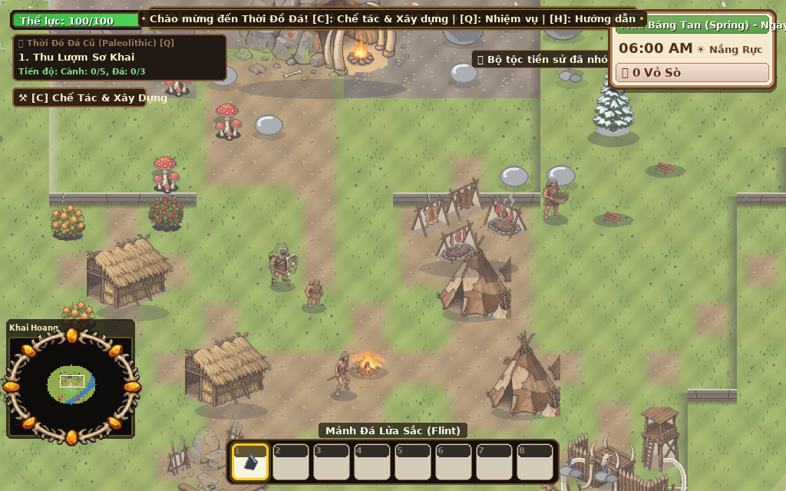

# 🌾 GREEN VALLEY TALES - NÔNG TRẠI HƯƠNG ĐỒNG GIÓ NỘI
> Game Mô Phỏng Nông Trại 2D Pixel Art Cổ Điển (Offline Single-Player)  
> Hỗ trợ chạy mượt mà đa nền tảng trên cả **Linux** và **Windows**



---

## 🎮 TÍNH NĂNG NỔI BẬT

1. **🌾 Trồng Trọt & 4 Mùa Luân Chuyển (Seasons & Farming):**
   * Canh tác theo ô lưới: Xới đất $\rightarrow$ Gieo hạt $\rightarrow$ Tưới nước $\rightarrow$ Sinh trưởng qua đêm $\rightarrow$ Thu hoạch.
   * Hệ thống cây trồng phong phú theo mùa: Củ cải mầm, Khoai tây, Dâu tây (Xuân); Cà chua, Bắp ngô, Dưa hấu (Hạ); Bí ngô, Cà tím (Thu). Cây tái sinh ra quả nhiều đợt.

2. **🪓 Khai Hoang & Mở Rộng Đất Đai (Land Clearing):**
   * Dùng Rìu chặt cành cây mục và gốc cây lấy Gỗ.
   * Dùng Cuốc chim phá đá nhỏ và tảng đá hoa cương lấy Đá & Quặng.
   * Dùng Liềm cắt cỏ dại lấy Sợi và dọn sạch mặt bằng trang trại.

3. **🐟 Sông Ngòi & Thủy Hải Sản (River & Fishing System):**
   * Dòng sông tự nhiên uốn lượn vắt ngang nông trại với cầu gỗ bắc ngang.
   * Cần câu tre & Minigame giật cá tương tác: Canh giữ cá trong thanh hứng lực.
   * Bảng danh lục các loài cá sông theo mùa và thời tiết: Cá chép, Cá vược, Cá trê đầm, Cá hồi đỏ, Cá hồi hoàng kim quý hiếm, Tôm sông.
   * Múc nước sông làm đầy Bình tưới.

4. **🐔 Chăn Nuôi Gia Súc & Gia Cầm (Livestock & Animals):**
   * Chuồng trại: Gà mái ta và Bò sữa đi dạo, gặm cỏ trên đồng cỏ xanh biếc.
   * Chăm sóc & Vuốt ve hàng ngày tăng điểm tình cảm (Hearts), thu hoạch Trứng tươi, Trứng vàng, Sữa tươi và Sữa đặc biệt.

5. **☀️ Chu Kỳ Ngày/Đêm & Thời Tiết Động (Day/Night & Weather):**
   * Đồng hồ sinh học 24 giờ (bắt đầu 06:00 sáng đến 24:00 đêm).
   * Bộ lọc ánh sáng chuyển dịch mượt mà: Bình minh vàng dịu, Ban trưa rực rỡ, Hoàng hôn tím cam, Màn đêm huyền ảo với đom đóm bay lượn và ánh đèn lồng hiên nhà.
   * Thời tiết biến đổi: Nắng ấm, Mưa rào (tự động tưới toàn bộ cây trồng), Bão sấm sét, Tuyết mùa đông.

6. **💰 Thùng Xuất Hàng & Cửa Hàng (Economy & Shipping):**
   * Thùng gửi hàng (Shipping Bin): Bỏ nông sản, cá, trứng sữa vào thùng, sáng hôm sau thương nhân trả tiền vàng (G) với bảng báo cáo doanh thu chi tiết.
   * Cửa hàng hạt giống (B): Mua hạt giống theo mùa, mua thêm gia súc (Gà, Bò) và rơm khô.

7. **🏘️ Hệ Thống Đa Khu Vực & Dịch Chuyển Tức Thời (Multi-Zone & Fast Travel):**
   * **Nông Trại (Farm Zone):** Khu thường trú với nhà ở, đồng ruộng phì nhiêu, chuồng gà bò, thùng xuất hàng, rương kho lớn 100 ô.
   * **Thị Trấn Hương Đồng (Town Zone):** Quảng trường trung tâm, đài phun nước cẩm thạch, bến dịch chuyển, các cửa tiệm và NPC cư dân.
   * **Teleport trên Bản Đồ (`M`):** Dịch chuyển tức thời 1-click giữa Nông Trại và Thị Trấn thông qua hệ thống Trụ Dịch Chuyển Waypoint. Có thể chạy bộ qua lại giữa 2 vùng theo con đường liên khu Đông - Tây.

8. **🤝 NPC Thị Trấn & Cơ Chế Trả Giá "Thuận Mua Vừa Bán" (Dynamic Haggling):**
   * **Cô Mai (Chủ Tiệm Nông Sản):** Bán hạt giống 4 mùa, phân bón; Thu mua nông sản, hoa quả, trứng sữa tươi giá tốt.
   * **Bác Bảy (Thợ Rèn & Khoáng Sản):** Bán than, quặng đồng/sắt, đá khối; Thu mua quặng thô, vàng vụn, geode.
   * **Cụ Ba Tri (Trưởng Thị Trấn):** Bán đèn lồng, mồi câu, bản đồ; Thu mua cá sông và các cổ vật lịch sử.
   * **Cơ Chế Trả Giá Động:** Người chơi có thể mặc cả khi Mua (-10%, -20%, -35%) hoặc đòi giá cao khi Bán (+10%, +20%, +35%). NPC có thanh **Độ Kiên Nhẫn (Patience)**, nếu ép giá quá đà NPC sẽ quạu và từ chối giao dịch!

9. **🐪 Thương Nhân Du Mục Thần Bí & Kho Báu Khai Hoang (Wandering Merchant & Relics):**
   * **Lão Hạc Du Mục:** Xuất hiện ngẫu nhiên vào các ngày cuối tuần/ngày may mắn ven sông nông trại với tấm thảm Ba Tư huyền ảo.
   * **Bán bảo vật độc bản:** Hạt giống Cổ Đại (Ancient Seed), Phân bón Thần Tốc, Cần câu Ngọc Bích, Tiên Dược Hồi Thể Lực.
   * **Thu mua Cổ vật Khai hoang với giá siêu thưởng (+70%):** Trong quá trình đập đá, chặt cây mục, xới đất có cơ hội đào được các cổ vật quý hiếm (Thạch anh huyền bí, Quặng vàng nguyên sinh, Nhựa hổ phách cổ, Gỗ hóa thạch, Tiền cổ, Gốm sứ cổ).

10. **💾 Lưu Trữ 100% Offline (Offline Save System v3.0):**
    * Tự động lưu game mỗi khi nhân vật vào nhà leo lên giường đi ngủ.
    * Dữ liệu lưu trữ an toàn trong file `saves/slot1.json`, lưu trọn vẹn trạng thái khu vực, kho đồ, thùng hàng, tâm trạng NPC.

---

> 📖 **Xem Tài Liệu Kế Hoạch & Kiến Trúc Tổng Thể Chi Tiết (23 Hạng Mục & 17 Phase):**  
> 👉 [docs/MASTERPLAN_AND_ROADMAP.md](file:///home/huyen1905/GCVL/docs/MASTERPLAN_AND_ROADMAP.md)

---

## 🕹️ BẢNG ĐIỀU KHIỂN KẾT HỢP CHUỘT & BÀN PHÍM (HYBRID CONTROLS)

Game hỗ trợ điều khiển linh hoạt kết hợp giữa **Chuột** và **Bàn phím** (tương tự các game ARPG / Stardew Valley):

| Thao tác Chuột | Hành động trong game |
| :--- | :--- |
| **Chuột Trái (Click vào ô gần)** | Dùng công cụ đang cầm (Cuốc đất, Tưới nước, Chặt cây, Đập đá, Quăng cần) hoặc Gieo hạt |
| **Chuột Trái (Click vào ô xa)** | **Tự động đi bộ đến vị trí đó (Click-to-Move)** với vòng sóng hiển thị |
| **Chuột Phải (Click vào ô gần)** | Tương tác nhanh: Thu hoạch cây chín, Vuốt ve gà/bò, Bỏ hàng vào thùng xuất, Đi ngủ |
| **Chuột Phải (Click vào ô xa)** | **Di chuyển nhân vật đến điểm chỉ định (Click-to-Move)** |
| **Cuộn Chuột / Click vào Hotbar** | Đổi công cụ / vật phẩm đang chọn; di chuột qua ô hiển thị Tooltip chi tiết |

| Phím Bàn Phím | Hành động bổ trợ |
| :--- | :--- |
| **W, A, S, D** hoặc **Phím Mũi Tên** | Di chuyển thủ công tự do 4 hướng (ngay lập tức ngắt di chuyển chuột) |
| **Phím 1 – 8** | Phím tắt chọn nhanh 8 ô trên thanh Hotbar |
| **SPACE (Phím Cách)** | Dùng công cụ / thao tác chính theo hướng nhân vật đang đứng |
| **Phím E** | Tương tác / thu hoạch / vuốt ve theo hướng nhân vật |
| **Phím B** | Mở / Đóng Cửa hàng hạt giống theo mùa & mua thêm gia súc |
| **Phím H** hoặc **F1** | Bật / Tắt bảng hướng dẫn phím tắt |
| **Phím ESC** | Đóng cửa sổ mở / Hủy giật cần câu |

---

## 🚀 HƯỚNG DẪN CÀI ĐẶT & CHẠY GAME

### 1. Trên Linux (Ubuntu, Debian, Fedora, Arch, Mint...)
```bash
# 1. Cài đặt thư viện phụ thuộc (nếu chưa có)
pip install -r requirements.txt

# 2. Khởi chạy game
python3 main.py
```

### 2. Trên Windows
```cmd
# 1. Mở Command Prompt (cmd) hoặc PowerShell tại thư mục game
pip install -r requirements.txt

# 2. Khởi chạy game
python main.py
```

### 3. Đóng gói thành file chạy `.exe` độc lập cho Windows (Tùy chọn)
Nếu bạn muốn tạo 1 file `.exe` duy nhất để gửi cho bạn bè click chơi ngay không cần cài đặt Python:
```cmd
pip install pyinstaller
pyinstaller --onefile --noconsole --name "GreenValleyTales" main.py
```
*File `GreenValleyTales.exe` hoàn chỉnh sẽ nằm trong thư mục `dist/`.*

---

## 📁 CẤU TRÚC DỰ ÁN
```text
GCVL/
├── main.py                     # File thực thi chính
├── requirements.txt            # Thư viện yêu cầu (pygame-ce)
├── README.md                   # Tài liệu hướng dẫn chơi & đóng gói
├── saves/                      # Dữ liệu lưu game offline (slot1.json)
└── src/
    ├── settings.py             # Tham số cấu hình, bảng màu, dữ liệu cây trồng, cá, vật nuôi
    ├── core/
    │   ├── game.py             # Bộ điều phối vòng lặp game chính
    │   ├── assets.py           # Bộ tạo đồ họa Pixel Art và âm thanh procedural
    │   ├── camera.py           # Camera 2D theo dõi nhân vật mượt mà
    │   ├── animals_manager.py  # Quản lý đàn gia súc và sản phẩm
    │   └── save_system.py      # Hệ thống lưu/nạp game offline JSON
    ├── world/
    │   ├── map_manager.py      # Bản đồ trang trại: Sông, cầu, đất xới, nhà, vật cản
    │   ├── time_system.py      # Đồng hồ 24h, 28 ngày/mùa, 4 mùa vụ
    │   └── weather_system.py   # Thời tiết & ánh sáng Ngày/Đêm động
    ├── entities/
    │   ├── player.py           # Nhân vật người chơi, thể lực, tương tác
    │   ├── crops.py            # Vòng đời sinh trưởng cây trồng
    │   ├── obstacles.py        # Chướng ngại vật khai hoang (cỏ, đá, cây mục)
    │   └── animals.py          # Gia súc (Gà, Bò, AI đi dạo, vuốt ve)
    ├── fishing/
    │   └── fishing_system.py   # Cần câu, sông ngòi & minigame giật cá
    ├── economy/
    │   ├── inventory.py        # Kho đồ 24 ô & Thanh phím tắt Hotbar
    │   ├── shipping_bin.py     # Thùng xuất hàng bán nông sản qua đêm
    │   └── shop.py             # Cửa hàng hạt giống theo mùa
    └── ui/
        ├── hud.py              # Hiển thị đồng hồ, mùa vụ, tiền vàng, thể lực, hotbar
        └── dialog.py           # Hộp thoại báo cáo thu nhập, cửa hàng, hướng dẫn
```
