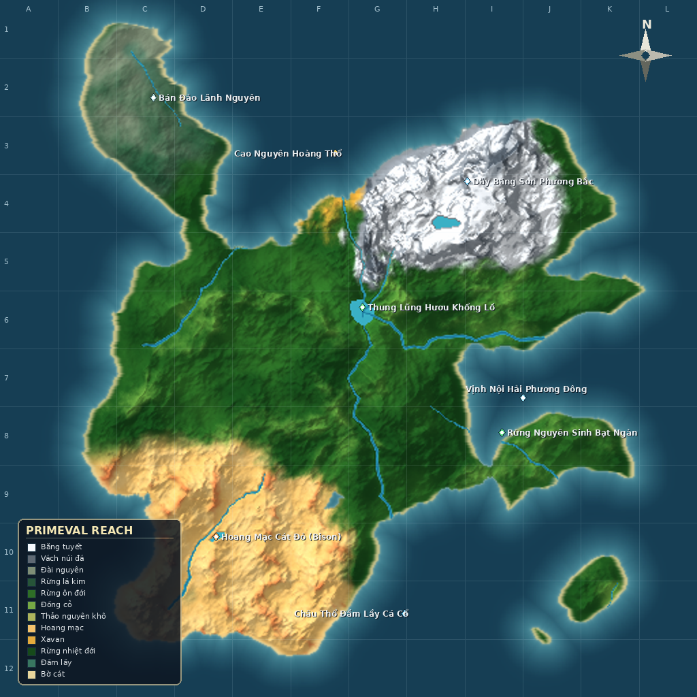

# 🦣 STONE AGE: PRIMEVAL WORLD
> **Bộ Mô Phỏng & Quan Sát Hệ Sinh Thái Tiền Sử 100% Hoang Dã Tự Nhiên**  
> *Prehistoric Primeval Nature Observation Simulator*  
> Tự nhiên nguyên sinh • Megafauna cổ đại • Thủy văn uốn khúc • Đại lục quần đảo Palworld



---

## 🌍 TỔNG QUAN HỆ SINH THÁI TỰ NHIÊN

Dự án được tái cấu trúc triệt để thành một **Hệ sinh thái tự nhiên nguyên sinh thuần túy**, loại bỏ hoàn toàn các yếu tố con người, nhà cửa, làng mạc hay kinh tế nhân tạo. Người xem đóng vai trò một nhà thám hiểm / quan sát viên tự do (Spectator Free Camera) theo dõi thế giới tiền sử vận động liên tục:

1. **🗺️ Đại Lục Quần Đảo Phong Cách Palworld (AAA Topographic Overworld):**
   * Quần đảo nguyên sinh khép kín giữa đại dương sâu với dải thềm san hô ngọc lam (Coastal Reef Halo).
   * 4 Quần xã sinh vật (Biomes) tương phản rõ nét:
     - **Bắc & Tây-Bắc:** Dãy núi tuyết và sông băng vĩnh cửu (Glacial Alpine Massif).
     - **Tây & Tây-Nam:** Hoang mạc đất đỏ và cồn cát gợn sóng (Terracotta Dunes).
     - **Trung Tâm & Đông:** Rừng rậm nguyên sinh xanh ngắt với thung lũng sông uốn lượn (Primeval Forest & River Valley).
     - **Đông-Bắc:** Cao nguyên thảm cỏ mùa thu (Autumn Steppes Plateau).
     - **Đông-Nam:** Đảo bảo tồn thánh địa biệt lập (Sanctuary Island).

2. **🌊 Thủy Văn Sông Ngòi Động Học (River Geomorphology & Hydraulics):**
   * Dòng sông uốn khúc tự nhiên (Meandering River) theo mô hình thủy lực thực tế:
     - Bờ lở (Cutbank) có vực sâu, ghềnh đá cuội ghồ ghề và thác nước tung bọt trắng.
     - Bờ bồi (Point Bar) thoải mịn với cát phù sa và sỏi thạch anh sáng lấp lánh.
     - Ghềnh đá tự nhiên lội nước (Stepping Stone Ford) nối hai bờ thung lũng.
     - Suối phụ lưu (Tributaries) bắt nguồn từ các khe núi tuyết đổ dồn về sông cái.

3. **🌲 Rừng Rậm 6 Tầng Tán & Thực Vật Cổ Sinh (Multi-Canopy Forest):**
   * Tầng cây vượt tán (Emergent Layer): Cây cổ thụ khổng lồ thân gỗ xù xì.
   * Tầng tán chính (Canopy): Thông tuyết phương bắc, cổ thụ xavan, vú sữa râm mát.
   * Tầng dưới tán (Understory): Dương xỉ cổ đại, vầu, dừa nước cọ cảnh.
   * Tầng cây bụi (Shrub Layer): Bụi quả dại (Wild Berry Bushes) chuyển 3 chu kỳ: Nảy mầm, Chín mọng, Tàn rụng.
   * Tầng thảm cỏ & rêu (Herb/Ground Layer): Thảm rêu ẩm ướt, nấm hoang dã.
   * Tầng rễ và thổ nhưỡng (Litter/Soil): Cành cây khô gãy, đất sét ven suối, quặng đồng lộ thiên.

4. **🦣 Động Vật Cổ Đại Độc Lập (Autonomous Prehistoric Megafauna AI):**
   * Hệ thống dã thú tự động tuần tra, tìm nước uống, gặm cỏ và săn đuổi tự nhiên:
     - **Voi Ma Mút (Mammoth):** Đàn thú khổng lồ có ngà cong, di chuyển chậm rãi trên đồng bằng và đài nguyên tuyết.
     - **Hổ Răng Kiếm (Sabertooth Smilodon):** Thú săn mồi đỉnh chóp rình rập trong bụi rậm, vồ mồi tốc độ cao.
     - **Bò Rừng Cổ Đại (Steppe Bison):** Bầy đàn gặm cỏ bình yên, chạy tán loạn khi gặp nguy hiểm.
     - **Gấu Hang & Chó Sói Băng (Cave Bear & Dire Wolf):** Canh giữ hang đá sườn núi.
     - **Cá Sấu Đầm Lầy & Đàn Cá Sông:** Bơi lội tự nhiên dọc theo dòng nước.
   * Để lại dấu chân (Animal Footprints) tự mờ dần trên bùn ướt và bờ cát.

5. **🌦️ Thời Gian & Thời Tiết Luân Chuyển Tự Nhiên:**
   * Đồng hồ tự nhiên 24 giờ liên tục không ngắt quãng (không có cơ chế ngất xỉu hay buộc phải nghỉ ngơi).
   * 4 Mùa khí hậu: Mùa Băng Tan (Spring), Mùa Nắng Hạ (Summer), Mùa Thu Rừng (Fall), Mùa Băng Giá (Winter).
   * Thời tiết tương tác mặt đất: Nắng ấm làm khô ráo đất đá; Mưa rào và bão tố làm dâng mực nước sông ngòi, tạo bùn lầy ven bờ.

---

## 🕹️ BẢNG ĐIỀU KHIỂN QUAN SÁT (SPECTATOR CONTROLS)

Hệ sinh thái vận hành theo cơ chế **Quan sát tự do (Spectator Free Camera)**:

| Phím / Thao tác | Chức năng quan sát |
| :--- | :--- |
| **W, A, S, D** hoặc **Mũi tên** | Di chuyển góc nhìn Camera mượt mà 4 hướng |
| **Giữ [SHIFT]** | Tăng tốc độ bay của Camera (Tốc độ cao để bao quát toàn cảnh) |
| **Q / E** | Hạ / nâng camera trong không gian 3D |
| **Giữ chuột phải + kéo** | Xoay góc nhìn camera 3D |
| **Phím M** | Bật / Tắt **Bản Đồ Toàn Cảnh (Overworld Atlas)** |
| **Click Chuột trên Bản đồ [M]** | Chuyển đổi giữa 3 lớp bản đồ: `[🗺️ Đại Lục]`, `[🏞️ Thung Lũng]`, `[🌿 Thảo Mộc]` |
| **Phím F1** | Bật / Tắt bảng hướng dẫn phím tắt |
| **Phím ESC** | Đóng cửa sổ bản đồ hoặc bảng trợ giúp |

---

## 🚀 HƯỚNG DẪN CÀI ĐẶT & KHỞI CHẠY

### 1. Khởi chạy Mô phỏng
```bash
# Khởi chạy trực tiếp trình mô phỏng
python3 main.py
```

Runtime mặc định sử dụng renderer OpenGL 3D với terrain mesh, perspective camera,
depth buffer và mặt đứng địa hình. Renderer Pygame 2D cũ vẫn có thể chạy để đối
chiếu bằng:

```bash
GCVL_RENDERER=2d python3 main.py
```

### 2. Kiểm thử Tự động (Headless Smoke Test Gate)
Dự án tích hợp bộ kiểm thử tự động đo đạc 300 khung hình liên tục không cần màn hình đồ họa:
```bash
python3 tools/smoke_test.py
```
* Tiêu chuẩn: 300 frames hoàn tất, FPS $\ge 65$, mã thoát 0.
