# 🌟 GREEN VALLEY TALES - MASTER PLAN & KIẾN TRÚC MỞ RỘNG TOÀN DIỆN
> **Dự án:** Green Valley Tales (Nông Trại Hương Đồng Gió Nội)  
> **Định vị:** Cozy Farming & Life Simulation kết hợp Chiều Sâu Kinh Tế, Khám Phá & Giao Thương Xã Hội  
> **Ngôn ngữ & Engine:** Python (pygame-ce 2D Pixel Art), Offline 100%, Đa nền tảng (Linux & Windows)

---

## 🧭 I. TẦM NHÌN THIẾT KẾ (DESIGN VISION & CORE PHILOSOPHY)

### 1.1. Từ Core Loop Đơn Giản đến Trò Chơi Có Chiều Sâu
Phiên bản tiền nhiệm đã hoàn thiện vững chắc **Core Farming Loop** bao gồm:
* Trồng trọt ô lưới theo mùa vụ (Xuân - Hạ - Thu - Đông)
* Thời tiết động & Chu kỳ ngày đêm 24h
* Khai hoang đất đai (cây cối, đá tảng, cỏ dại)
* Sông ngòi & Minigame câu cá
* Chăn nuôi gia súc (Gà, Bò, điểm hảo cảm Hearts, sản phẩm trứng/sữa)
* Kinh tế cơ bản (Thùng xuất hàng Shipping Bin, Kho đồ nâng cấp 100 ô, Túi đồ 64 ô)

Tuy nhiên, nếu chỉ dừng lại ở loop: **Làm ruộng $\rightarrow$ Bán nông sản $\rightarrow$ Nâng cấp công cụ**, trải nghiệm sẽ dần trở nên đơn điệu. Để nâng tầm game thành một tác phẩm có linh hồn, thế giới trong game phải **sống động, đa tầng và kết nối xã hội**, nhưng **vẫn giữ nguyên sự thư thái (Cozy Sim)**, tránh rơi vào bẫy phình to vô tội vạ (Feature Bloat).

### 1.2. Ba Trụ Cột Phát Triển Bền Vững
```
                      ┌────────────────────────────────────────┐
                      │          GREEN VALLEY TALES            │
                      └──────────────────┬─────────────────────┘
                 ┌───────────────────────┼────────────────────────┐
                 ▼                       ▼                        ▼
        ┌──────────────────┐    ┌──────────────────┐    ┌──────────────────┐
        │  CORE GAMEPLAY   │    │  CONTENT & LIFE  │    │ LONG-TERM METAS  │
        │                  │    │                  │    │                  │
        │ • Farming        │    │ • NPC & Thị Trấn │    │ • Skills (1-10)  │
        │ • Multi-Zone     │    │ • Trả giá (Haggle│    │ • Farm Building  │
        │ • Khai hoang     │    │ • Thương nhân hiếm│   │ • Automation     │
        │ • Câu cá/Khoáng  │    │ • Nhiệm vụ/Event │    │ • Museum/Collec. │
        └──────────────────┘    └──────────────────┘    └──────────────────┘
```

1. **Nhóm Core Gameplay (Ưu tiên số 1):** Giữ độ mượt mà, cảm giác điều khiển (hybrid chuột + phím), chia tách khu vực (Trang trại $\leftrightarrow$ Thị trấn), cơ chế khai hoang rớt đồ cổ quý hiếm.
2. **Nhóm Xã hội & Nội dung (Ưu tiên số 2):** Các NPC thị trấn có cá tính, cơ chế buôn bán có trả giá "thuận mua vừa bán", thương nhân du mục mang hàng hiếm ghé trang trại.
3. **Nhóm Tiến trình dài hạn (Ưu tiên số 3):** Kỹ năng, nâng cấp nhà, tự động hóa tưới tiêu, chế biến ẩm thực sâu, lễ hội 4 mùa.

---

## 🏛️ II. BẢN ĐỒ 12 PHÂN HỆ LỚN (12 GAME SUBSYSTEMS)

```mermaid
graph TD
    subgraph FarmingSim["🌾 HỆ SINH THÁI GREEN VALLEY TALES"]
        subgraph WorldSys["1. THẾ GIỚI & MÔI TRƯỜNG"]
            TimeSys["Time System (24h/28 ngày)"]
            WeatherSys["Weather & Lighting Engine"]
            ZoneSys["Multi-Zone (Farm / Town / Forest / Mine)"]
            FastTravel["Fast Travel / Map Teleport"]
        end

        subgraph PlayerSys["2. NGƯỜI CHƠI & ĐIỀU KHIỂN"]
            HybridCtrl["Hybrid Mouse & Keys / Click-to-Move"]
            StaminaSys["Stamina & Energy Management"]
            SkillsSys["Skill Trees (Farming, Fishing, Mining...)"]
            InventorySys["Inventory (Hotbar 8, Bag 64, Storage 100)"]
        end

        subgraph ContentSys["3. TÀI NGUYÊN & NỘI DUNG"]
            CropsData["Crops Lifecycle & Re-harvest"]
            AnimalsData["Livestock AI & Emotional State"]
            Excavation["Rare Relics & Artifact Drops"]
            MineData["Minerals, Ores, Geodes"]
        end

        subgraph EconomySys["4. KINH TẾ & GIAO THƯƠNG"]
            ShippingBin["Shipping Bin (Overnight Profit)"]
            TownMarket["Town Market & NPC Shops"]
            HagglingSys["Bargaining Engine (Thuận mua vừa bán)"]
            WanderingMerchant["Wandering Rare Merchant (Lão Hạc)"]
        end

        subgraph SocialSys["5. XÃ HỘI & SỰ KIỆN"]
            NPCSchedule["NPC Daily Routine & Dialogue"]
            FriendshipSys["Friendship / Hearts Progression"]
            QuestSys["Daily & Story Quests"]
            Festivals["Seasonal Festivals & Competitions"]
        end
    end

    WorldSys --> PlayerSys
    PlayerSys --> ContentSys
    ContentSys --> EconomySys
    EconomySys --> SocialSys
```



---

## 🗺️ III. HỆ THỐNG ĐA KHU VỰC & DỊCH CHUYỂN TỨC THỜI (MULTI-ZONE & FAST TRAVEL)

### 3.1. Phân vùng Địa lý (World Zones)
Game chia bản đồ thế giới thành các không gian sống chuyên biệt:

1. **🌾 Trang Trại (Farm Zone - 50x40 Tiles):**
   * Khu thường trú của người chơi.
   * Tập trung sản xuất: Đất xới màu mỡ, dòng sông uốn lượn, chuồng gà bò, nhà chính (giường ngủ, bếp), thùng xuất hàng, rương kho lớn.
   * Bãi khai hoang: Chứa chướng ngại vật đá, gỗ, cỏ dại có cơ hội đào được Cổ vật quý hiếm.
   * Lối ra phía Đông: Con đường đất đỏ dẫn thẳng sang Thị Trấn Hương Đồng.

2. **🏘️ Thị Trấn Hương Đồng (Town Zone - 50x40 Tiles):**
   * Khu trung tâm văn hóa, thương mại và hội họp.
   * **Quảng trường trung tâm:** Đài phun nước đá cẩm thạch, bồn hoa rực rỡ, bảng thông báo nhiệm vụ thị trấn, đèn đường thắp sáng khi đêm xuống.
   * **Tiệm Nông Sản Cô Mai:** Chuyên các loại hạt giống theo mùa, cây ăn quả, phân bón cao cấp.
   * **Lò Rèn Bác Bảy:** Mua bán khoáng thạch, nâng cấp công cụ, đập vỡ Geode bí ẩn.
   * **Quán Trà & Tạp Hóa Cụ Ba Tri:** Điểm giao lưu, bán đồ thủ công và thu mua nông sản, thủy hải sản.
   * **Bến dịch chuyển (Teleport Waypoint):** Trụ đá ma thuật kết nối với Trang Trại.

3. **🌲 Rừng Thần Bí & Mỏ Khoáng Sản (Dự kiến Phase 9):**
   * Rừng sâu phía Bắc khai thác gỗ quý, nấm rừng và thảo dược.
   * Hầm mỏ 50 tầng khám phá quặng đồng, sắt, vàng, kim cương và sinh vật bóng đêm.

### 3.2. Cơ chế Dịch Chuyển Tức Thời (Map Teleportation)
* **Bản Đồ Toàn Cảnh (`M`):** Hiển thị trực quan 2 khu vực Trang Trại & Thị Trấn.
* **Teleport 1 Click:** Người chơi click vào nút `[⚡ Dịch chuyển đến Thị Trấn]` hoặc `[⚡ Dịch chuyển về Nông Trại]` (hoặc click trực tiếp lên biểu tượng Waypoint trên bản đồ).
* **Hiệu ứng mượt mà:** Phát chuông ma thuật (`chime`), hiệu ứng hạt bụi sao lấp lánh (sparkle particles), lập tức chuyển màn hình và đưa nhân vật đến vị trí đích an toàn mà không tốn công chạy bộ.
* **Đi bộ liên vùng:** Nếu không muốn teleport, người chơi vẫn có thể chạy bộ qua lối đi ranh giới Đông - Tây nối giữa 2 vùng.

---

## 🤝 IV. HỆ THỐNG NPC & CƠ CHẾ TRẢ GIÁ "THUẬN MUA VỪA BÁN" (BARGAINING ENGINE)

### 4.1. Hệ thống NPC Thị Trấn
Mỗi NPC có tính cách, ngành nghề, kho hàng và phản ứng hội thoại riêng biệt:

| NPC | Chức Danh | Tính Cách | Mặt Hàng Chuyên Doanh | Mức Độ Hào Sảng |
| :--- | :--- | :--- | :--- | :--- |
| **Cô Mai** | Chủ Tiệm Nông Sản | Xởi lởi, vui vẻ, thích nông dân siêng năng | Hạt giống 4 mùa, phân bón, cây ăn quả; Mua nông sản, hoa quả, trứng sữa | Cao (Dễ thương lượng) |
| **Bác Bảy** | Thợ Rèn & Khoáng Sản | Cộc cằn, thẳng tính, trọng chữ tín | Quặng sắt, đồng, than, công cụ; Mua đá, quặng thô, vàng, geode | Trung bình - Nghiêm khắc |
| **Cụ Ba Tri** | Trưởng Thị Trấn | Thông thái, hào sảng, trọng lịch sử | Bản đồ cổ, đồ gia dụng, vé sự kiện; Mua cá sông, cổ vật, đồ thủ công | Cao (Thích đồ hiếm) |

### 4.2. Cơ chế Trả Giá Động (Dynamic Haggling System)
Khi giao dịch mua hoặc bán, người chơi không bị ép giá cố định mà có thể **Thương lượng giá**:
1. **Giao Dịch Nhanh (Standard Deal):** Mua / bán ngay theo giá niêm yết (100% thành công).
2. **Ba Mức Trả Giá:**
   * **Thận Trọng (-10% khi Mua / +10% khi Bán):**
     * Tỷ lệ thành công cơ bản: **85%**.
     * Phù hợp cho giao dịch thường ngày, tích tiểu thành đại.
   * **Vừa Phải (-20% khi Mua / +20% khi Bán):**
     * Tỷ lệ thành công cơ bản: **60%**.
     * Cần cân nhắc tâm trạng NPC.
   * **Ép Giá Gắt (-35% khi Mua / +35% khi Bán):**
     * Tỷ lệ thành công cơ bản: **30%**.
     * Rủi ro cao nhưng đem lại món hời cực lớn!
3. **Thanh Kiên Nhẫn Của NPC (NPC Patience - 100%):**
   * Nếu trả giá thất bại, kiên nhẫn của NPC giảm 25% - 40%.
   * Nếu kiên nhẫn về 0%: NPC bực tức hủy thương lượng mặt hàng đó trong ngày ("Giá này tôi bán lỗ vốn, cậu đi chỗ khác giùm!").
   * Nếu trả giá thành công: NPC mỉm cười chốt đơn, người chơi nhận lời khen và giữ nguyên sự kiên nhẫn.

---

## 🐪 V. THƯƠNG NHÂN DU MỤC & KHO BÁU KHAI HOANG (WANDERING MERCHANT & EXCAVATION)

### 5.1. Thương Nhân Thần Bí Ghé Thăm (Lão Hạc Du Mục)
* **Quy luật xuất hiện:** Không có lịch cố định, xuất hiện ngẫu nhiên vào các ngày may mắn hoặc cuối tuần (Thứ Sáu & Chủ Nhật).
* **Thông báo sáng sớm:** Có tiếng chuông lạc đà và Toast chào buổi sáng: *"🌟 Thương nhân du mục huyền bí đã dựng lều ven sông trang trại hôm nay!"*
* **Hình ảnh đặc trưng:** Tấm thảm dệt Ba Tư cổ kính, lồng đèn tỏa ánh sáng huyền bí, lạc đà gặm cỏ ven sông.

### 5.2. Mặt Hàng Độc Bản Khan Hiếm
* **Hạt Giống Cổ Đại (Ancient Seed - 500G):** Cây trồng huyền thoại sinh trưởng trong mọi mùa, cho quả Hoàng Kim bán giá 1,200G.
* **Phân Bón Hoàng Gia (Magic Fertilizer - 150G):** Tăng tốc sinh trưởng gấp đôi, tỷ lệ quả to sao vàng +50%.
* **Cần Câu Ngọc Bích (Legendary Rod - 2,000G):** Cần câu thần kỳ, kích thước thanh hứng cá x1.5, dễ dàng bắt cá hiếm.
* **Tiên Dược Sinh Lực (Energy Elixir - 120G):** Uống vào hồi 100% thanh thể lực tức thì, không lo ngất xỉu.
* **Phiếu Mở Rộng Thần Kỳ (Storage Voucher - 800G):** Mở thêm ô chứa đồ miễn phí không cần gom vật liệu.

### 5.3. Cổ Vật Khai Hoang & Thu Mua Giá Cao
Khi người chơi phát quang trang trại, có tỷ lệ rơi ra các vật phẩm cổ vô giá:
* **Đập đá tảng granite:** 15% rơi ra `Thạch Anh Huyền Bí (Mystic Geode)` (350G) hoặc `Quặng Vàng Tự Nhiên (Gold Nugget)` (500G).
* **Chặt cây to & gốc cây mục:** 12% rơi ra `Nhựa Hổ Phách Cổ (Ancient Amber)` (280G) hoặc `Gỗ Hóa Thạch (Petrified Wood)` (380G).
* **Dùng Cuốc xới đất:** 5% đào trúng `Đồng Tiền Triều Đại Cổ (Ancient Coin)` (220G) hoặc `Cổ Vật Gốm Sứ (Clay Relic)` (420G).
* **Đặc quyền Thương Nhân Du Mục:** Mua lại toàn bộ cổ vật này với **giá thưởng thêm +50% đến +80%** so với đem bỏ thùng xuất hàng!

---

## 📈 VI. LỘ TRÌNH PHÁT TRIỂN 17 GIAI ĐOẠN (17-PHASE ROADMAP)

```
[Phase 1-7: HOÀN THÀNH]
  ├── Phase 1: Core Engine, Hybrid Controls, Pixel Art Canvas
  ├── Phase 2: Land Clearing, Stumps, Rocks, Weeds
  ├── Phase 3: Farming Grid, 4-Season Crops, Soil Hydration
  ├── Phase 4: River, Water Animation, Fishing Rod & Catch Minigame
  ├── Phase 5: Livestock (Chickens, Cows, Hearts, Fresh Products)
  ├── Phase 6: Economy (Shipping Bin, Day/Night Lighting, Weather, Save/Load)
  └── Phase 7: Polish (Minimap, Full Map, Bag 64 slots, Storage 100 slots, Mouse Move)

[Phase 8: HIỆN THỰC HÓA NGAY LẬP TỨC (CURRENT)]
  ├── Phase 8.1: Multi-Zone Architecture (Trang Trại & Thị Trấn Hương Đồng)
  ├── Phase 8.2: Map Teleportation & Waypoint Fast Travel System
  ├── Phase 8.3: Town NPCs (Cô Mai, Bác Bảy, Cụ Ba Tri) & Dialogues
  ├── Phase 8.4: Dynamic Haggling / Bargaining Engine (Thuận mua vừa bán)
  ├── Phase 8.5: Wandering Rare Merchant Event & Exotic Goods Catalogue
  └── Phase 8.6: Land Excavation Rare Artifacts Drops & Economy Integration

[Phase 9-17: KẾ HOẠCH DÀI HẠN (FUTURE EXPANSIONS)]
  ├── Phase 9: Exploration & Deep Mine (Hầm mỏ 50 tầng, quặng kim loại, đá quý)
  ├── Phase 10: Quest System (Nhiệm vụ hàng ngày, bảng tin thị trấn, chuỗi quest NPC)
  ├── Phase 11: Cooking System & Buffs (Món ăn gia đình, hồi stamina, buff tốc độ)
  ├── Phase 12: Skill & Progression (Level 1-10: Nông nghiệp, Câu cá, Khai mỏ...)
  ├── Phase 13: Building & Farm Customization (Hàng rào, lối đi lát gạch, đèn vườn)
  ├── Phase 14: Farm Automation (Hệ thống vòi phun nước Sprinklers, máng ăn tự động)
  ├── Phase 15: Animal AI & Breeding (Nhân giống gia súc, tính cách vật nuôi)
  ├── Phase 16: Dynamic World Events & Festivals (Lễ hội mùa xuân, thi câu cá)
  └── Phase 17: Museum / Collection & Data-Driven Modding (Bảo tàng cổ vật, JSON schema)
```

---

## 💾 VII. KIẾN TRÚC DỮ LIỆU & SAVE MIGRATION

Để đảm bảo tương thích ngược 100% với các file lưu cũ (`saves/slot1.json`), cấu trúc lưu trữ được nâng cấp lên chuẩn `save_version: 3`:
```json
{
  "save_version": 3,
  "current_zone": "farm",
  "player": {
    "x": 1560.0,
    "y": 1750.0,
    "stamina": 100.0,
    "current_zone": "farm"
  },
  "time": {
    "year": 1,
    "season_id": "spring",
    "day": 1,
    "hour": 6,
    "minute": 0
  },
  "inventory": { "gold": 500, "bag_capacity": 16, "items": [...] },
  "storage": { "capacity": 20, "items": [...] },
  "wandering_merchant_present": true,
  "town_npcs_mood": {
    "co_mai": { "patience": 100, "friendship": 0 },
    "bac_bay": { "patience": 100, "friendship": 0 },
    "cu_ba_tri": { "patience": 100, "friendship": 0 }
  }
}
```

---
*Tài liệu được cập nhật tự động và theo sát toàn bộ quá trình phát triển mã nguồn của dự án Green Valley Tales.*
